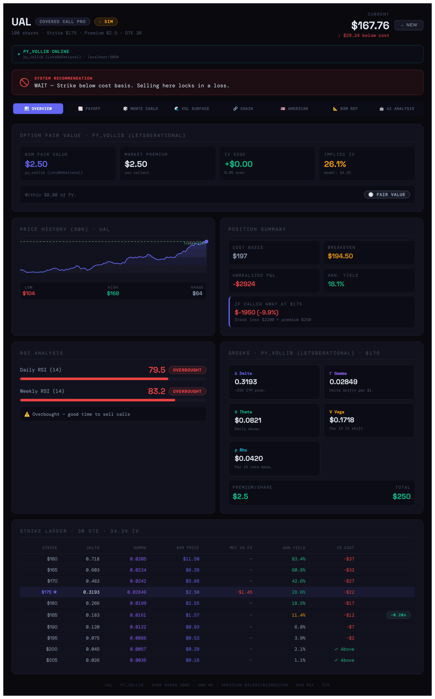
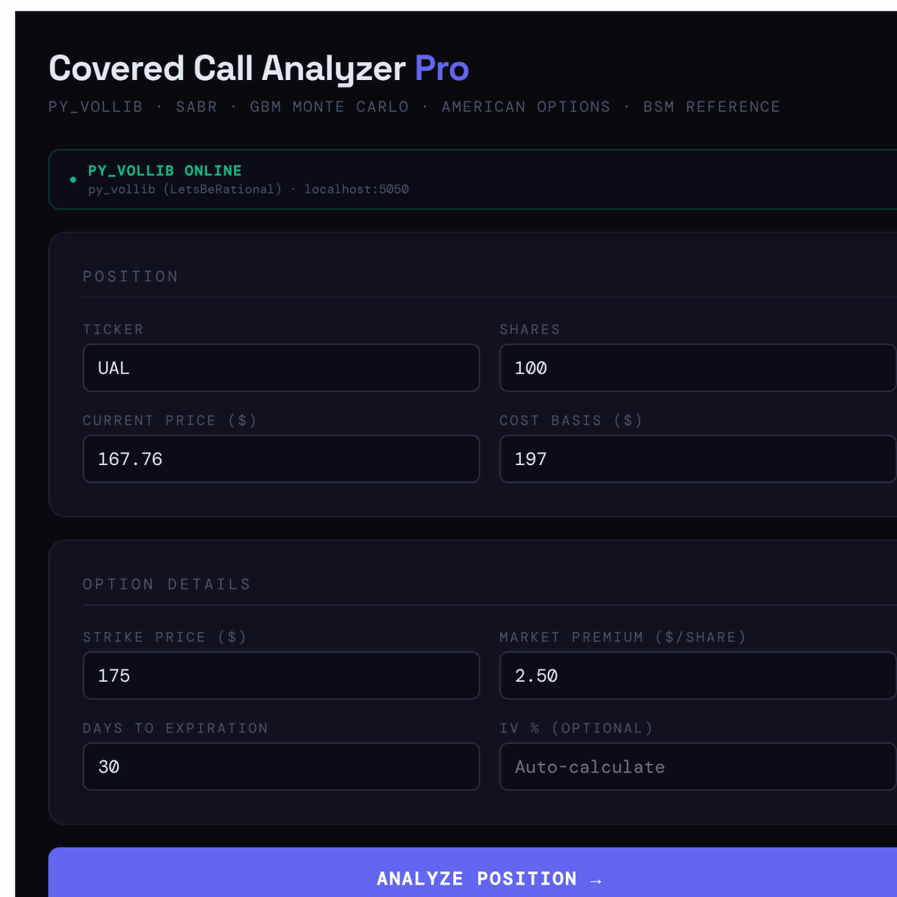
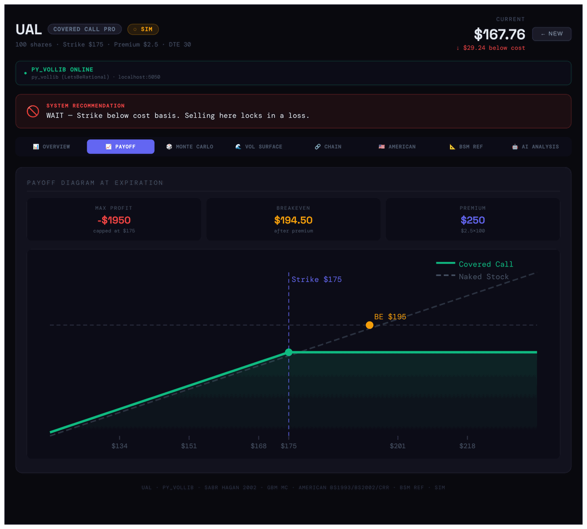
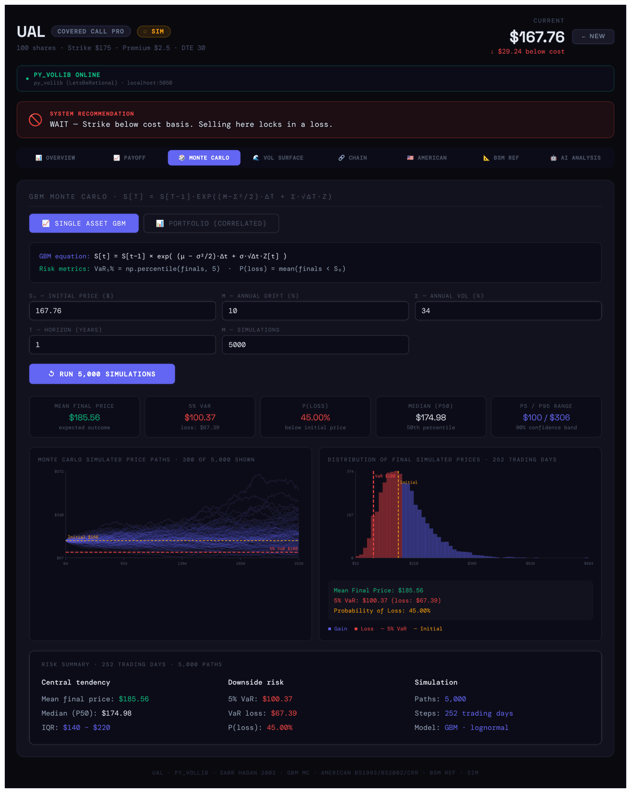
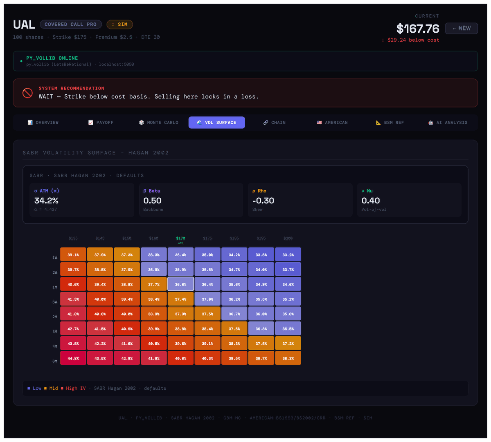
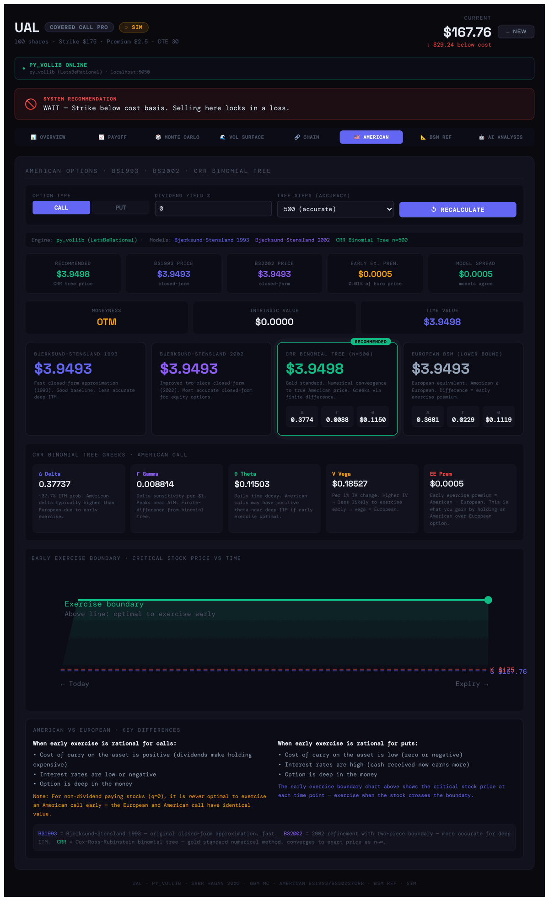
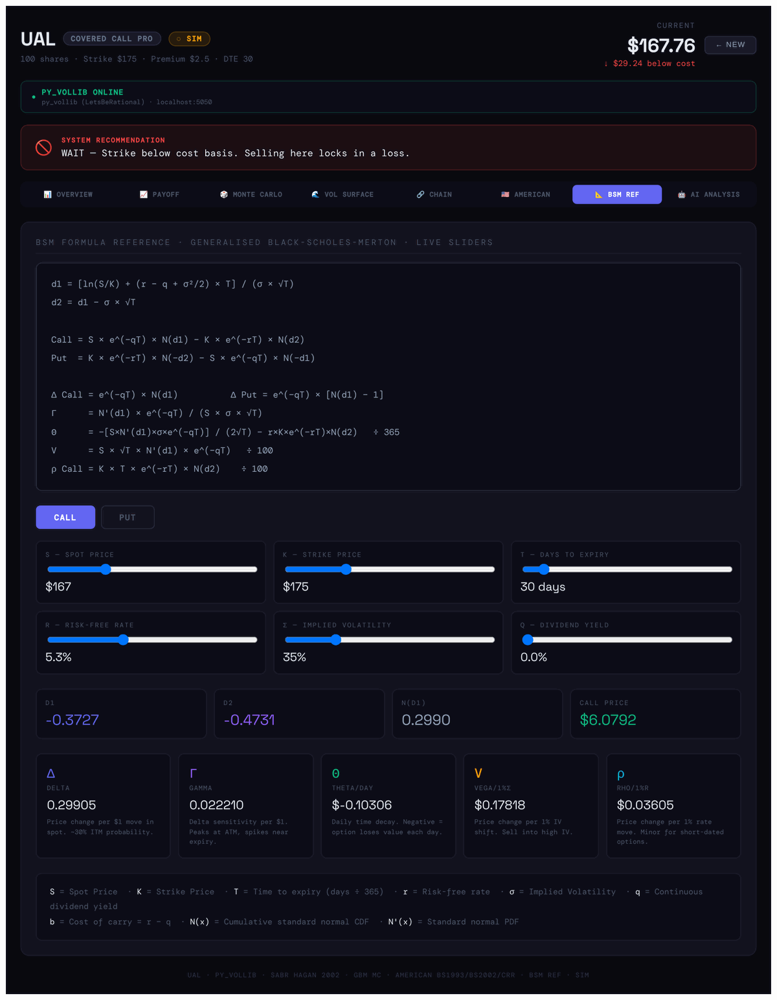

# Covered Call Analyzer Pro

Interactive React dashboard for analysing a **covered-call** trade: should you sell the call, at which strike, and what can happen to the position until expiry. A small Flask + `py_vollib` server does the heavy option maths. The front-end still works without it, using JavaScript fallbacks.

> ⚠️ Educational project. Not financial advice. When Yahoo Finance is unreachable the app switches to **simulated prices** (the `SIM` badge), and the screenshots below were taken in that mode.



---

## What you'll find in the dashboard

### 1. Position form


Enter the ticker, the number of shares, the current price, your **cost basis**, and the call you plan to sell: strike, premium and days to expiration. IV is optional; leave it empty and the app estimates it from 30-day historical volatility.

The top badge shows whether the Python engine is running (`PY_VOLLIB ONLINE`).

<br clear="right"/>

### 2. Overview
- **System recommendation**: 🔴 *WAIT* if the strike is below your cost basis, so being called away locks in a loss. Otherwise you get a verdict based on RSI and pricing.
- **Option fair value**: the BSM fair value vs the premium you collect, the implied IV and the IV edge. It tells you whether the premium is rich, fair or cheap.
- **Position summary**: breakeven, unrealised P&L, annualised yield and the P&L if the shares are called away.
- **RSI (daily and weekly)** and a 90-day price chart with your cost basis and strike.
- **Greeks** for the chosen strike: Δ, Γ, Θ, Vega and ρ.
- **Strike ladder**: delta, gamma, BSM price, annualised yield and the distance to cost basis for every strike from ATM to +25%.

### 3. Payoff


Payoff at expiration of the covered call compared with holding the stock alone. It shows the strike, the breakeven, the capped max profit and the premium collected. Max profit turns red when it is negative (strike below cost basis).

<br clear="right"/>

### 4. Monte Carlo (GBM)


Geometric Brownian motion simulation, `S[t] = S[t-1]·exp((μ − σ²/2)Δt + σ√Δt·Z)`, with editable drift, volatility, horizon and number of paths. It displays:
- simulated price paths and the distribution of final prices
- mean / median final price, **5% VaR**, **P(loss)** and the P5–P95 band
- a **Portfolio (correlated)** mode for several assets, using a Cholesky-decomposed correlation matrix

<br clear="right"/>

### 5. Volatility surface: SABR (Hagan 2002)


Implied-volatility heatmap across strikes (−20% to +20%) and maturities (1 week to 6 months), built from the SABR model. It shows the **put skew**: lower strikes carry higher IV. When a live option chain is available, SABR is **calibrated to the market quotes**. Otherwise it uses default parameters around the position's IV.

<br clear="right"/>

### 6. Option chain
Live calls and puts from Yahoo Finance, for strikes from −15% to +20% around spot. Each contract is enriched with py_vollib Greeks and compared with the SABR IV, so mispriced strikes are easy to spot. This tab needs internet access.

### 7. American options


Compares the prices of an American option under three models:
- **Bjerksund-Stensland 1993** and **2002** (closed-form approximations)
- **CRR binomial tree** (100–1,000 steps) with finite-difference Greeks
- the European BSM price as the lower bound

It also shows the **early-exercise premium** and the **early-exercise boundary** chart, along with notes on when early exercise is rational. You can switch between call and put, and change the dividend yield and the number of tree steps.

<br clear="right"/>

### 8. BSM reference


The generalised Black-Scholes-Merton formulas (d1, d2, call/put, all Greeks) with **live sliders** for S, K, T, r, σ and q. Move a slider and see exactly how each term and Greek changes. It works well as a study aid.

<br clear="right"/>

### 9. AI analysis (optional)
Sends every number in the dashboard (pricing, Greeks, SABR, RSI, position) to Claude and returns a written strategy review. You need your own Anthropic API key (see below).

---

## Quick start

**1. Python engine (optional but recommended)**
```bash
pip install -r requirements.txt
python greeks_server.py            # http://localhost:5050   (Windows: start_greeks_server.bat)
```

**2. Front-end**
```bash
npm install
npm run dev                        # http://localhost:5173
```
Without the Python server, the dashboard falls back to a JavaScript Black-Scholes pricer, and the BS2002/CRR models in the American tab are not available.

## API keys
This repository contains **no API keys**. The only key is optional and is used for the **AI Analysis** tab:
```bash
cp .env.example .env               # Windows: copy .env.example .env
```
```
VITE_ANTHROPIC_API_KEY=sk-ant-...
```
`.env` is in `.gitignore`, so it is never committed.
🔒 Variables starting with `VITE_` are bundled into the browser code, so run this app **locally only** and do not deploy it publicly with your key.

## Repository layout
| Path | Content |
|---|---|
| `src/App.jsx` | Main app: form, overview, payoff, SABR surface, chain, AI |
| `src/AmericanOptions.jsx` | BS1993 / BS2002 / CRR tab |
| `src/MonteCarloGBM.jsx` | GBM Monte Carlo (single asset + correlated portfolio) |
| `src/BSMReference.jsx` | Interactive BSM formula sheet |
| `greeks_server.py` | Flask API: `/greeks`, `/american`, `/surface`, `/chain`, `/monte-carlo`, `/health` |
| `ual-dashboard-react/`, `ual-dashboard-single-file/` | Earlier dashboards focused on a UAL position |
| `covered-call-pro/` | Previous version, kept for reference |
| `docs/images/` | Screenshots used in this README |

## Tech
React 18 · Vite · Python · Flask · py_vollib (LetsBeRational) · SABR · Bjerksund-Stensland · CRR binomial tree · GBM Monte Carlo

## Credits
The GBM / Monte Carlo tab (`MonteCarloGBM.jsx`) is adapted from Kyle Dickinson's [quant-simulations-and-risk](https://github.com/k-dickinson/quant-simulations-and-risk).

**Author:** Rodrigo Chemite Barbosa · [github.com/ch3m1bb5](https://github.com/ch3m1bb5)
